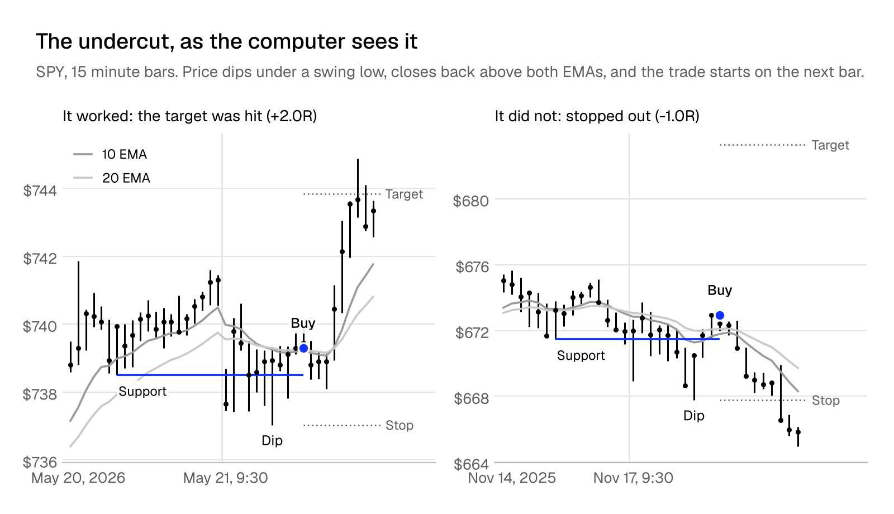
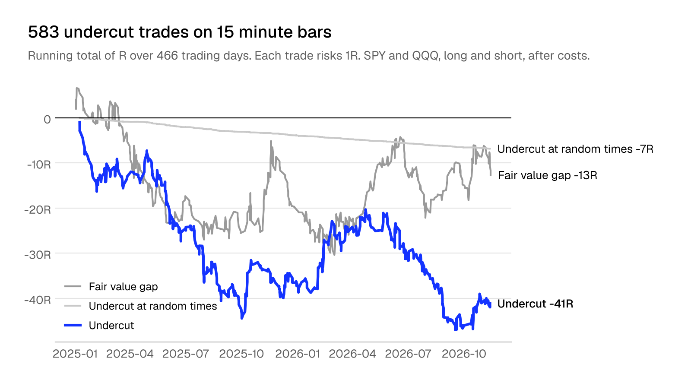
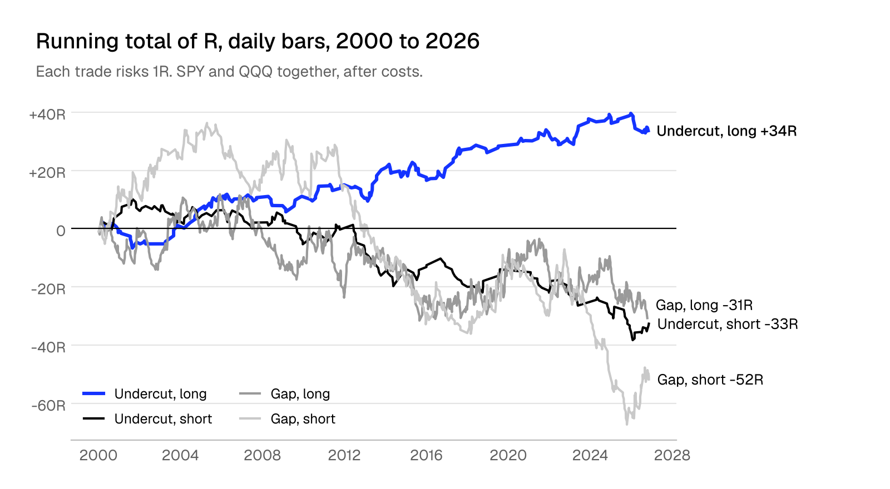
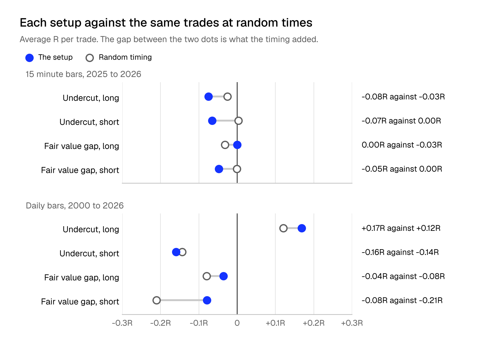
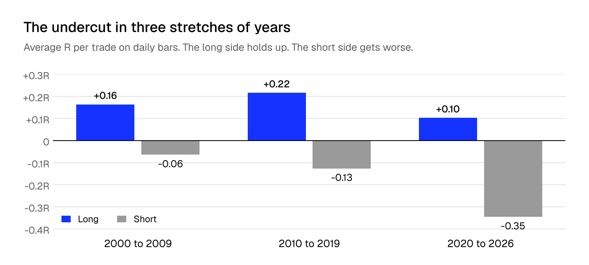
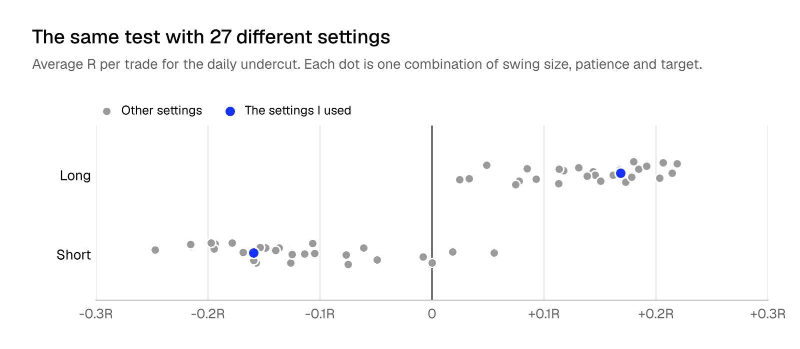
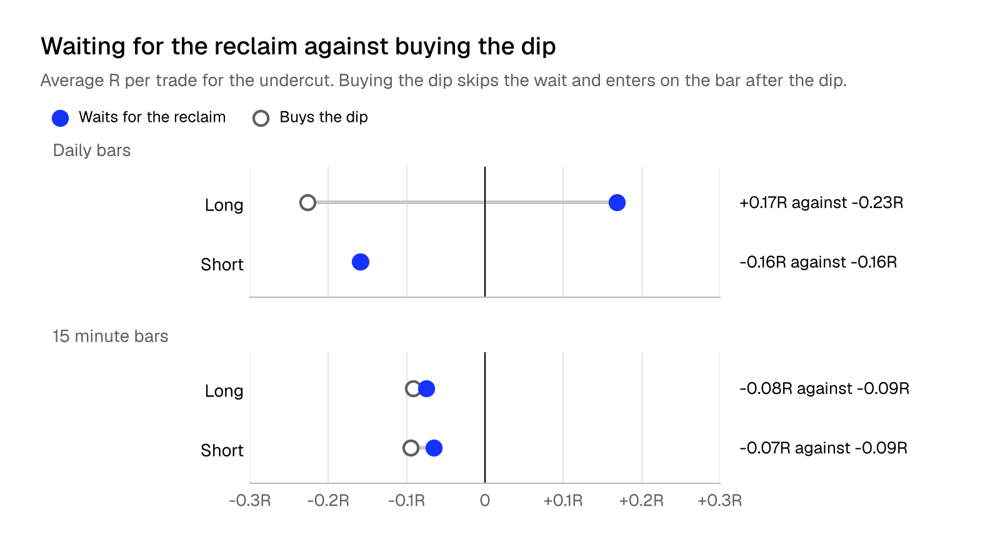

# Testing my own trading setup

I paper trade SPY, SPX and QQQ with a setup I call the undercut, plus fair value gaps. On a chart both look convincing. I wanted to know what is left when a computer follows them with no judgment, so I wrote each one down as fixed rules and had it take every trade.

I ran two tests:

- **Market hours, 15 minute bars.** Every full trading day from January 2, 2025 to November 13, 2026: 466 days.
- **Daily bars.** January 2000 to November 2026: 26 years.

The short version:

- **On 15 minute bars the undercut lost.** 583 trades, 44% winners, -0.07R a trade. The same trades at random times did better.
- **On daily bars the long side made money.** 200 trades, 56% winners, +0.17R a trade. Most of that was the market going up.
- **On the daily long side, waiting for the reclaim made the difference.** +0.17R a trade, against -0.23R for buying the dip.
- **The short side and fair value gaps lost** on both timeframes.

**This is a backtest of rules, not a record of my trading.** A computer took every trade here. None of them are mine, and there are no results from my own account.

## The setups, as rules



**The undercut, long**

1. Support is the most recent swing low: a bar whose low is the lowest of the five bars before it and the five after.
2. The dip: a bar trades below that level.
3. The reclaim: within 10 bars, a bar closes back above the level and above both the 10 and 20 bar EMA.
4. Buy at the next bar's open. The stop goes at the lowest low of the dip.
5. Take profit at twice the risk. If neither is hit, close the trade after 20 bars on the daily chart, or at the end of the day on the 15 minute chart.

The short version is the mirror image above a swing high.

I draw support by eye. A computer cannot, so step 1 is my stand-in for it, and it is the biggest difference between how I trade and what was tested.

**The fair value gap, long**

1. Three bars leave a gap: the low of the third is above the high of the first, by at least a quarter of the average bar range.
2. If price comes back down to the top of the gap within 10 bars, buy there.
3. The stop goes at the bottom of the gap. Same target and time limit as above.

Again the short version is the mirror image.

**On 15 minute bars** nothing is held overnight and no trade is opened in the last half hour. A level made the afternoon before still counts the next morning.

**Scoring.** Every trade risks 1R, the distance from entry to stop. A trade that hits its target makes 2R, and one that hits its stop loses 1R. When a single bar touches both the stop and the target, I count it as the stop.

**Costs.** On daily bars I charge 0.02% of the price each way. On 15 minute bars the stops are much closer, so that same charge would take about 0.07R off every trade and decide the result by itself. There I charge 0.002% each way, a little over a cent a share on SPY, and show the result before costs as well.

The rule settings (swing size, patience, target and time limit) were fixed before running anything and not tuned afterwards. A later section shows what 27 other settings would have done. The one number I changed after a first run was the cost on 15 minute bars, down from 0.01% each way, because that was several times the real spread on SPY. The 15 minute undercut loses at either figure, and before costs.

## The data

**15 minute bars.** SPY and QQQ, regular session only, 9:30 to 4:00 New York time, from January 2, 2025 to November 13, 2026. I kept full days only: 466 days of 26 bars, 12,116 bars for each fund. They are built from one minute bars from Strasmore's public market data service.

I wanted fifteen years of intraday prices. Free sources do not go back that far, and this one starts in January 2025. So the market-hours test covers every day I could get, and the long history comes from daily bars.

**Daily bars.** SPY and QQQ from January 2000 to November 17, 2026: 6,760 bars each, adjusted for dividends and splits, from Yahoo Finance.

As a check on the two sources, I compared the last 15 minute close of each day with Yahoo's daily close. Their day to day moves have a correlation of 0.998 for SPY and above 0.999 for QQQ.

I did not test SPX separately because SPY tracks it. The prices are not in this repository because they are not mine to share. `get_intraday.py` and `get_data.py` download them.

## 583 trades on 15 minute bars



| Setup | Trades | Winners | Average | Before costs | Total |
|---|---:|---:|---:|---:|---:|
| Undercut, long | 302 | 47% | -0.08R | -0.07R | -23R |
| Undercut, short | 281 | 41% | -0.07R | -0.06R | -18R |
| Fair value gap, long | 279 | 42% | 0.00R | +0.01R | 0R |
| Fair value gap, short | 263 | 37% | -0.05R | -0.04R | -13R |

The undercut lost in both directions: 583 trades and -41R in total. Costs are not the reason. Before costs it still averaged -0.06R a trade.

The "then it flies" part of the setup is rarer than it feels. Of the 583 undercut trades, 34 reached the 2R target, 177 were stopped out and 372 were still open at the end of the day.

## 26 years of daily bars



| Setup | Trades | Winners | Average | Total |
|---|---:|---:|---:|---:|
| Undercut, long | 200 | 56% | +0.17R | +34R |
| Undercut, short | 205 | 34% | -0.16R | -33R |
| Fair value gap, long | 857 | 34% | -0.04R | -31R |
| Fair value gap, short | 654 | 31% | -0.08R | -52R |

One of four ends above zero. Even there, the average could plausibly be anywhere from +0.02R to +0.32R.

Of the 200 long undercut trades, 23 reached the 2R target, 75 were stopped out and 102 ran out the 20 bars.

## Was it the setup, or the market?

Over these 26 years SPY returned 706% and QQQ 724% with dividends. Almost any way of buying them made money. So a profit on the long side proves very little by itself.

To separate the two, I took every real trade and placed 200 copies of it at random times: same direction, same stop distance, same target and time limit. If the setup's timing is worth something, the real trades should beat the random ones.



| Bars | Setup | The setup | Random timing | Chance random does as well |
|---|---|---:|---:|---:|
| 15 minute | Undercut, long | -0.08R | -0.03R | 86% |
| 15 minute | Undercut, short | -0.07R | 0.00R | 91% |
| 15 minute | Fair value gap, long | 0.00R | -0.03R | 28% |
| 15 minute | Fair value gap, short | -0.05R | 0.00R | 78% |
| Daily | Undercut, long | +0.17R | +0.12R | 27% |
| Daily | Undercut, short | -0.16R | -0.14R | 58% |
| Daily | Fair value gap, long | -0.04R | -0.08R | 19% |
| Daily | Fair value gap, short | -0.08R | -0.21R | 1% |

On 15 minute bars the undercut did worse than random timing in both directions.

On daily bars the long undercut beat random timing by about 0.05R a trade. A gap that size turns up by luck about one time in four, so I cannot claim the timing adds anything.

The daily short fair value gap is the odd one. It clearly loses less than shorting at random, and it still loses.

## Does the daily long side hold up?



It made money in each of three stretches: +0.16R a trade in 2000 to 2009, +0.22R in 2010 to 2019 and +0.10R since 2020. It was positive in both funds, +0.19R on SPY and +0.15R on QQQ. The short side lost in all three stretches and got worse each time.



I also reran the daily undercut with 27 combinations of swing size (3, 5 or 8 bars), patience (5, 10 or 15 bars) and target (1.5R, 2R or 3R). The long side made money in all 27, from +0.02R to +0.22R a trade, and beat random timing in 18. The short side lost in 24 of 27.

So the long result does not hang on the settings I happened to pick. What it hangs on is being long a market that went up.

## What waiting was worth

The undercut has a wait built into it. After the dip, do nothing until price closes back above the level and both EMAs. To see what that wait is worth, I ran an impatient version that buys the open of the bar after the dip, with the stop under that bar.



| Bars | Side | Waits for the reclaim | Buys the dip |
|---|---|---:|---:|
| Daily | Long | +0.17R | -0.23R |
| Daily | Short | -0.16R | -0.16R |
| 15 minute | Long | -0.08R | -0.09R |
| 15 minute | Short | -0.07R | -0.09R |

On daily bars, long, the wait made the difference. Buying the dip took 243 trades, won 29% of them and lost 0.23R a trade. Waiting for the reclaim made +0.17R a trade from the same levels.

On 15 minute bars the wait bought almost nothing, and I would not lean on even that. Buying the dip puts the stop very close, and trades with a stop closer than 0.2% of the price are skipped. With that filter loosened to 0.1%, the impatient long version came out at 0.00R against -0.07R for waiting, and the two short versions tied at -0.08R.

Two other things I noticed:

- **Most days there is nothing to do.** On 259 of 466 days SPY gave no undercut trade at all. QQQ gave none on 239, and on 182 days neither did.
- **The slower chart is the one that worked.** The same rules lost on 15 minute bars and made money on the long side of daily bars, where a trade lasts days.

I also split the 15 minute trades by the hour they started, to see if sitting out part of the day would help. Nothing consistent came out of it. Trades entered at 9:45 roughly broke even (149 trades, +0.01R), the 10 o'clock hour lost 0.14R a trade and the 2 o'clock hour was the worst at -0.20R.

## What it means in money

If every 15 minute undercut trade had risked half a percent of the account, the 583 trades would have cost about 21% of it in under two years.

If every daily long undercut trade had risked 1%, it would have added about 34% over 26 years, before compounding, with a worst losing run of about 9%. A trade was open roughly a fifth of the time.

Holding SPY over the same years returned 706%, with a worst drop of 55%.

So this is not a replacement for owning the index. At best the daily version is a way of choosing when to add to it.

## What I take from it

1. **On 15 minute bars, the rule version of my setup does not work.** It lost in both directions and did worse than random entries. If my own day trades do better than that, my judgment is adding it, and I have not measured that yet.
2. **The daily long side is small, if it is there at all.** It made money in every period and under every setting, but I cannot show it beats buying at random.
3. **"It works both ways" was wrong** for the rule version. The short side lost on both timeframes.
4. **The comparison mattered more than the backtest.** Without the random-timing test, +34R over 26 years would have looked like proof.
5. **Waiting is the part that held up.** On the daily long side the reclaim was the difference between making and losing money, most days had no setup, and the slower chart beat the faster one.
6. **My eye might add something the rule cannot.** The way to find out is to mark the level on each paper trade before the outcome is known and compare those trades with the rule's.

Mostly it has taught me to wait.

## Limits

- The rule is not my eye. I choose which levels matter and skip setups I do not like. The test takes every one.
- The 15 minute test covers under two years, which is one stretch of one market. I could not get free intraday prices from further back.
- SPY and QQQ move together, so these are fewer independent bets than the trade counts suggest.
- Bars cannot show what happened first inside them. Where it mattered I assumed the worse outcome.
- Costs are an assumption.
- Eight main tests were run: four setups on two timeframes. One came in under 5%, and it is a setup that still loses money. The waiting comparison and the hour split came afterwards, so read them as observations.
- This tests the shares. It says nothing about options on them.

## Files

```
README.md         this write-up
analysis.ipynb    the notebook, with every number and chart
setups.py         the two setups as rules, and the trade simulator
backtest.py       runs everything and writes results/
charts.py         draws the seven charts
get_intraday.py   downloads the 15 minute bars into data/
get_data.py       downloads the daily bars into data/
results/          every simulated trade and every summary table
test_setups.py    32 tests: the rules on hand-made bars, a check for look-ahead, and this page against results/
```

To rerun:

```
pip install -r requirements.txt
python get_intraday.py
python get_data.py
python backtest.py
python charts.py
pytest
```

Both sources revise and extend their prices over time, so a fresh download can shift a few trades. The numbers on this page come from the files in `results/`, made on November 18, 2026.

Nothing here is investment advice.

Built using Claude as my coding tool.
